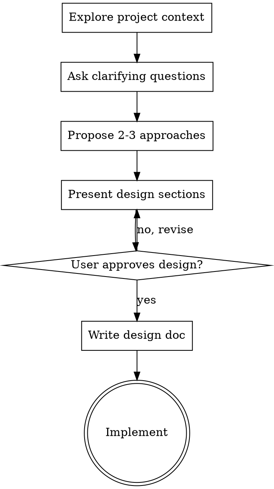

# Brainstorming Ideas Into Designs

## Overview

Help turn ideas into fully formed designs through collaborative dialogue.

Start by understanding the current project from `AGENT.md` and the codebase, then ask questions one at a time to refine the idea. Once you understand what you're building, present the design and get user approval.

<HARD-GATE>
Do NOT invoke any implementation skill, write any code, scaffold any project, or take any implementation action until you have presented a design and the user has approved it. This applies to EVERY project regardless of perceived simplicity.
</HARD-GATE>

## Anti-Pattern: "This Is Too Simple To Need A Design"

Every project goes through this process. A todo list, a single-function utility, a config change — all of them. "Simple" projects are where unexamined assumptions cause the most wasted work. The design can be short (a few sentences for truly simple projects), but you MUST present it and get approval.

## Checklist

You MUST create a task for each of these items and complete them in order:

1. **Explore project context** — check files, docs, recent commits
2. **Ask clarifying questions** — one at a time, understand purpose/constraints/success criteria
3. **Propose 2-3 approaches** — with trade-offs and your recommendation
4. **Present design** — in sections scaled to their complexity, get user approval after each section
5. **Write design doc** — save to `docs/plans/YYYY-MM-DD-<topic>-design.md` and commit
6. **Transition to implementation** — if the work is a ticket in `docs/todo/`, invoke the `implement-ticket` skill; otherwise proceed to implementation

## Process Flow

**The terminal state is implementation.** Do NOT write code, scaffold, or invoke an implementation skill until the design is approved and written down. If the work is a ticket, the next skill is `implement-ticket`.

## The Process

**Understanding the idea:**
- Read `AGENT.md` first — purpose, architecture, principles, and out-of-scope
- Check the current project state (source, docs, recent commits)
- Review existing patterns in the codebase before proposing new ones
- Ask questions one at a time to refine the idea
- Prefer multiple choice questions when possible, but open-ended is fine too
- Only one question per message — if a topic needs more exploration, break it into multiple questions
- Focus on understanding: purpose, constraints, success criteria

**Exploring approaches:**
- Propose 2-3 different approaches with trade-offs
- Prefer approaches that match existing project patterns and the principles in `AGENT.md`
- Present options conversationally with your recommendation and reasoning
- Lead with your recommended option and explain why

**Presenting the design:**
- Once you believe you understand what you're building, present the design
- Scale each section to its complexity: a few sentences if straightforward, up to 200-300 words if nuanced
- Ask after each section whether it looks right so far
- Cover the sections that matter for this change, derived from `AGENT.md` and the codebase (for example: data model, interfaces, error handling, testing strategy)
- Be ready to go back and clarify if something doesn't make sense

## After the Design

**Documentation:**
- Write the validated design to `docs/plans/YYYY-MM-DD-<topic>-design.md`
- Include only the sections relevant to this change
- Use the `commit` skill to commit the design document

**Implementation:**
- If the work is a ticket in `docs/todo/`, invoke the `implement-ticket` skill
- Otherwise proceed to implementation
- Do not start implementation from this skill

## Project-Specific Considerations

Derive constraints from `AGENT.md` and the codebase. Do not assume a stack or domain.

Typical questions to answer from project context, not from this skill:
- What architecture and runtime constraints apply?
- Which existing patterns should new work follow?
- What is explicitly out of scope?
- How should the change be tested? (use the test command from `AGENT.md`)

## Key Principles

- **One question at a time** — Don't overwhelm with multiple questions
- **Multiple choice preferred** — Easier to answer than open-ended when possible
- **YAGNI ruthlessly** — Remove unnecessary features from all designs
- **Explore alternatives** — Always propose 2-3 approaches before settling
- **Incremental validation** — Present design, get approval before moving on
- **Be flexible** — Go back and clarify when something doesn't make sense
- **Follow the project** — Use `AGENT.md` principles and existing codebase patterns
- **Keep it generic** — Never hardcode a stack, framework, or domain into the design process
