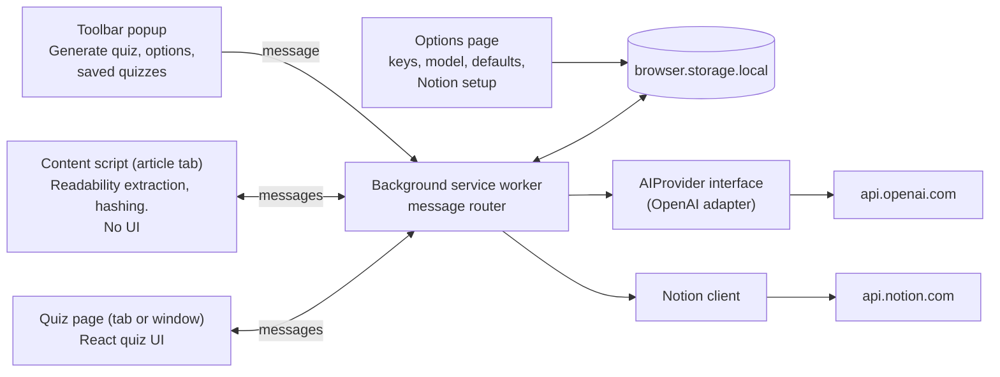

# Quizify Roadmap

Quizify is a Safari extension for macOS. It uses AI to generate a quiz about the webpage you're reading, then saves a summary of the page (with a backlink) and your quiz attempt to Notion. The goal is to turn passive reading into active recall.

## Core workflow

1. Visit a webpage (e.g. an article about agent harness architecture).
2. Click the Quizify toolbar icon to open the popup.
3. Optionally adjust question count, difficulty, and question types, then click **Generate quiz**.
4. The quiz opens in a new tab (or, if chosen in settings, a separate window). It shows the total number of questions ("Question 3 of 10") but presents one question at a time. You can answer, **Skip**, go to the **Previous** question, or save for later.
5. Whether you finish now or stop partway through, a **Save quiz** button writes the page summary and the quiz entry to Notion. Unfinished quizzes are saved as *In progress* and can be resumed later from Notion.

## Decisions

| Area | Decision |
| --- | --- |
| Platform | macOS Safari only |
| Distribution | Personal build first; decide on distribution later |
| Users | Built so others can use it, with everyone bringing their own API keys |
| Backend | None. The extension calls the AI provider and Notion APIs directly |
| AI provider | Pluggable adapter interface; OpenAI is the only adapter in v1 |
| Stack | TypeScript + Vite + React |
| Content | Article-style HTML pages only in v1 |
| Quiz UI | A dedicated extension page; nothing visible is injected into the article |
| Quiz location | Setting: new tab (default) or a separate window placed beside the article |
| Question types | Configurable per quiz: multiple choice, true/false, short answer |
| Count & difficulty | Chosen per quiz (e.g. 5/10/15; easy/medium/hard), with defaults in settings |
| Feedback | At the end: score, correct answers, explanations, supporting quotes from the page |
| Notion layout | Two related databases: **Sources** and **Quizzes** |
| Notion setup | Paste an integration token and pick a parent page; Quizify creates both databases |
| Save for later | Saved to Notion as *In progress*; resumed by loading it back from Notion |
| Content hash | SHA-256 of the extracted article text, saved to Notion and used to detect when the page's material has changed |
| Extra metadata | AI-generated topic tags on each Source |
| Roadmap pacing | Phases with milestones, no dates |

## Architecture



Key constraints that shape this design:

- **All network calls go through the background worker.** The Notion API doesn't send CORS headers, so it can't be called from a content script or a page. The background worker can call it because the manifest declares `host_permissions` for `api.openai.com` and `api.notion.com`.
- **The quiz runs on its own extension page (`quiz.html`), not in the popup or the article.** Safari closes the toolbar popup as soon as focus leaves it, which would destroy quiz state. The popup only starts generation. The background worker then opens `quiz.html?quizId=…` in a new tab or window, depending on the setting.
- **The article page only gets a small content script with no visible UI.** It extracts the article text and computes the content hash.
- **Every answer is grounded in a verbatim quote from the page.** Quotes are extracted during generation, checked against the extracted text, shown on the results screen, and saved to Notion.
- **Content scripts can't be ES modules**, so the content script is built as a single IIFE bundle. The popup, options page, quiz page, and background worker use a normal multi-entry Vite build.
- **A Safari web extension ships inside a native macOS app.** The web extension lives in its own folder, and an Xcode project wraps it.

### Proposed project structure

```
quizify/
  ROADMAP.md
  extension/
    public/
      manifest.json           # move the current root manifest.json here
      icons/
    src/
      background/             # service worker: message router, API calls, opening quiz tab/window
      content/                # extraction, hashing (no UI)
      quiz-page/              # React quiz UI (quiz.html)
      popup/                  # Generate quiz, per-quiz options, saved quizzes
      options/                # settings + Notion setup
      lib/
        providers/            # AIProvider interface + openai.ts
        notion/               # client, schema creation, read/write mappers
        quiz/                 # types, JSON schema, grading, state reducer
        extract/              # Readability wrapper, text cleanup, content hash
        url.ts                # URL normalization
    vite.config.ts
    vite.content.config.ts    # IIFE build for the content script
  xcode/                      # Safari wrapper app (generated)
```

### Data model (sketch)

```ts
type QuestionType = "multiple_choice" | "true_false" | "short_answer";

interface Question {
  id: string;
  type: QuestionType;
  prompt: string;
  choices?: string[];          // multiple_choice and true_false
  correctAnswer: string;       // choice text, "True"/"False", or a model answer
  explanation: string;
  sourceQuote: string;         // verbatim excerpt from the page that supports the answer
}

interface Answer {
  questionId: string;
  value?: string;
  skipped: boolean;
  grade?: "correct" | "partial" | "incorrect";
  feedback?: string;           // short_answer only, from AI grading
}

interface Quiz {
  id: string;
  source: {
    url: string;
    normalizedUrl: string;
    title: string;
    contentHash: string;       // SHA-256 hex of the normalized extracted text
  };
  summary: string;
  tags: string[];
  settings: { count: number; difficulty: "easy" | "medium" | "hard"; types: QuestionType[] };
  questions: Question[];
  answers: Answer[];
  currentIndex: number;
  status: "in_progress" | "completed";
  startedAt: string;           // ISO timestamps
  completedAt?: string;
  score?: number;              // 0-100
  notion?: { sourcePageId: string; quizPageId: string };
}
```

### Notion schema

**Sources** database (one row per webpage):

| Property | Type | Notes |
| --- | --- | --- |
| Name | Title | Page title |
| URL | URL | Backlink to the page |
| Content hash | Rich text | SHA-256 of the extracted text when the Source was last saved |
| Summary | Rich text | Truncated to fit Notion's 2,000-character limit per text item; the full summary also goes in the page body |
| Tags | Multi-select | AI-generated topics |
| Quizzes | Relation | Two-way relation to Quizzes |
| Captured | Created time | Automatic |

**Quizzes** database (one row per attempt; retaking a page's quiz adds a new row):

| Property | Type | Notes |
| --- | --- | --- |
| Name | Title | e.g. "Agent Harness Architecture: Quiz (Nov 23, 2026)" |
| Source | Relation | Links to the Sources row |
| Content hash | Rich text | Hash of the page content this quiz was generated from |
| Status | Select | In progress / Completed |
| Score | Number (percent) | Set on completion |
| Started | Date | Includes time |
| Completed | Date | Includes time; empty while in progress |

**Quiz page body:**

- One section per question: the question, the choices, your answer, and a **toggle block** containing the correct answer, the explanation, and the source quote. Toggles keep in-progress quizzes from spoiling the answers.
- A final "Quizify data — do not edit" code block holding the full `Quiz` JSON. This is what the extension reads back when resuming. A code block's text is split into multiple text items because each item is limited to 2,000 characters.

## Phases

### Phase 0 — Foundations

Goal: an empty extension that builds, loads in Safari, and can open a quiz page from the popup.

- [ ] Scaffold `extension/` with Vite, React, and TypeScript; add ESLint, Prettier, and Vitest
- [ ] Write the MV3 `manifest.json`: `action` popup, `background.service_worker`, content script, `options_ui`, `storage`/`activeTab`/`scripting` permissions, and `host_permissions` for the OpenAI and Notion APIs
- [ ] Configure two builds: multi-entry (popup, options, quiz page, background) and IIFE (content script)
- [ ] Generate the Xcode wrapper with `xcrun safari-web-extension-converter` (or Xcode's Safari Extension App template), pointing it at the build output
- [ ] Sign with a free Apple ID personal team so the extension stays enabled. Unsigned builds work too (Safari > Develop > Allow Unsigned Extensions), but that setting resets every time Safari relaunches
- [ ] Set up a typed message bus between popup, content script, quiz page, and background
- [ ] Clicking a button in the popup opens a "Hello" `quiz.html` tab that displays the article tab's title (fetched through the content script)

**Done when:** `npm run build` plus an Xcode run loads Quizify in Safari, and the popup can open a quiz page that talks to the article tab.

### Phase 1 — Settings and connections

Goal: a user can bring their own keys and set up Notion without touching code.

- [ ] Options page sections: AI provider (OpenAI only for now), API key, model; quiz defaults (count, difficulty, types); quiz location (tab or window, default tab); Notion
- [ ] **Test connection** buttons for OpenAI and Notion
- [ ] Notion setup flow:
  1. Instructions for creating an internal integration and sharing a parent page with it
  2. Paste the token, then pick the parent page from a search of pages the integration can access
  3. **Create databases** builds Sources, then Quizzes with a two-way relation, and stores both IDs
- [ ] Pin the `Notion-Version` header. API versions from 2025-09-03 onward split databases into "data sources", so creating databases, adding relations, and querying need to target data source IDs. Choose a version and code against it consistently.
- [ ] Store settings in `browser.storage.local`, and state clearly in the UI that keys are stored locally and never sent anywhere except their own API

**Done when:** a fresh install can be configured end to end, and both databases appear in Notion with the correct schema.

### Phase 2 — Content extraction and hashing

Goal: reliable clean text and a stable content hash from article pages.

- [ ] Run Mozilla Readability on a cloned `document` in the content script
- [ ] Clean the output: collapse whitespace, keep headings and list structure as plain-text markers
- [ ] Cap the input length (e.g. about 12k words) and warn when a page is truncated
- [ ] Detect pages that aren't articles (too little text, or Readability fails) and show a clear message instead of generating a bad quiz
- [ ] URL normalization: strip the fragment, common tracking parameters (`utm_*`, `fbclid`, etc.), and trailing slashes. This normalized URL is how Sources are matched.
- [ ] Content hash: SHA-256 via `crypto.subtle.digest`, stored as hex
  - Hash the cleaned Readability text, not the raw HTML. Ads, timestamps, and scripts change raw HTML on every load and would make every visit look like a change.
  - Normalize before hashing (Unicode NFC, collapse whitespace, trim) so cosmetic differences don't change the hash
  - Hash the full extracted text before the length cap, so truncation doesn't affect it
- [ ] Unit tests against a few saved HTML fixtures (docs page, blog post, news article), including tests that the same content always produces the same hash and an edited paragraph produces a different one

**Done when:** extraction returns clean text, a title, and a stable hash for representative article pages, and fails gracefully elsewhere.

### Phase 3 — Quiz generation

Goal: one click produces a valid, grounded quiz, summary, and tags.

- [ ] Define the `AIProvider` interface (`generateQuiz`, `gradeShortAnswers`, `testConnection`) so adding providers later doesn't touch the UI
- [ ] Implement the OpenAI adapter using Structured Outputs (JSON Schema response format) so responses always parse
- [ ] A single generation call returns `{ summary, tags, questions[] }` and respects the chosen count, difficulty, and types
- [ ] Prompt rules: questions must be answerable from the page alone; every question includes a verbatim `sourceQuote`; distractors must be plausible; no trivia about the site itself
- [ ] Validate the output: correct count and types, a `correctAnswer` that matches one of the `choices`, and a `sourceQuote` that actually appears in the extracted text (fuzzy match). Retry once with the specific errors if validation fails.
- [ ] Popup options (count, difficulty, types) prefilled from the defaults
- [ ] Generation flow: the popup asks the background to extract and hash the page, the background opens the quiz page right away, and the quiz page shows a loading state while generation runs. A Cancel button aborts the request (`AbortController`).

**Done when:** generation succeeds on the Phase 2 fixtures, and validation catches malformed or ungrounded questions.

### Phase 4 — Quiz page UI

Goal: the one-question-at-a-time experience from the workflow.

- [ ] Open the quiz according to the setting: `tabs.create` next to the article tab, or `windows.create` sized to sit beside the article. Check whether Safari honors a compact popup-style window, and fall back to a normal window if not.
- [ ] Header shows the page title (linked back to the article) and "Question N of M", plus a progress bar
- [ ] Renderers for each question type: radio choices, true/false, and a textarea for short answer
- [ ] Controls: **Previous**, **Skip**, **Next**, **Finish**, **Save quiz**
- [ ] Skipped questions are marked in the progress bar and can be revisited
- [ ] Finishing with skipped or unanswered questions asks for confirmation; those questions count as incorrect
- [ ] Quiz state lives in a reducer and is autosaved to `storage.local` keyed by quiz ID (with an index by normalized URL), so reloading or closing the quiz tab doesn't lose progress
- [ ] Keyboard support: number keys pick choices, arrow keys navigate
- [ ] Follows the system light/dark appearance

**Done when:** a user can take a full quiz with skip and back navigation in either a tab or a window, and progress survives closing and reopening the quiz.

### Phase 5 — Grading and results

Goal: an end-of-quiz review that teaches, not just scores.

- [ ] Grade multiple choice and true/false locally
- [ ] Grade short answers with one batched `gradeShortAnswers` call returning correct/partial/incorrect plus one line of feedback each (partial counts as half a point)
- [ ] Results screen: score, then every question with your answer, the correct answer, the explanation, and the supporting quote from the page
- [ ] Short-answer grading uses the question's source quote as the reference, so grades are based on what the page says rather than the model's general knowledge
- [ ] Record `completedAt` and `score`

**Done when:** finishing any quiz produces an accurate score and a full review screen with a supporting quote for every question.

### Phase 6 — Save to Notion

Goal: **Save quiz** writes everything to Notion, whether the quiz is finished or not.

- [ ] Find or create the Source: query Sources by normalized URL; create the row (with its content hash) if it's missing; otherwise update the summary, content hash, and tags
- [ ] Create the Quiz row (or update it if it already has a `quizPageId`) with its relation, content hash, status, timestamps, and score
- [ ] Write the page body: question sections with answer toggles, then the JSON data block. When updating, remove the old body blocks and append fresh ones (a single append request is limited to 100 blocks, so batch it).
- [ ] Serialize requests and back off on HTTP 429 to stay under Notion's limit of about 3 requests per second
- [ ] Saving from the results screen marks the quiz *Completed*; saving partway through marks it *In progress*
- [ ] Success toast with an **Open in Notion** link; clear error messages for a bad token, an unshared page, or deleted databases

**Done when:** both completed and in-progress quizzes appear correctly in Notion with content hashes, and saving twice updates the same row instead of duplicating it.

### Phase 7 — Resume from Notion

Goal: quizzes saved for later can be picked back up.

- [ ] When the popup opens on a page, look up its Source and any related *In progress* quizzes; show **Resume quiz** alongside **Generate new quiz**
- [ ] A **Saved quizzes** list in the popup queries Quizzes where Status is *In progress* and shows the page title and date. Selecting one opens the article and the quiz page.
- [ ] Load state by reading the JSON data block from the Quiz page and validating it against the current schema version
- [ ] Prefer the local autosave if it's newer than the Notion copy
- [ ] When the popup opens on a page, compare the current content hash with the saved Source's hash. If they differ, show "This page has changed since you last saved it" in the popup and on any resumed quiz.
- [ ] Completing a resumed quiz updates the same Notion row to *Completed*

**Done when:** a quiz saved partway through on one day can be resumed and completed later, ending up as a single completed Notion entry, and changed pages are flagged.

### Phase 8 — Polish and hardening

Goal: dependable enough to hand to someone else who brings their own keys.

- [ ] First-run onboarding that walks through the Phase 1 setup
- [ ] Consistent error handling: network failures, invalid keys, quota errors, oversized pages
- [ ] Check Safari's background worker lifetime during long OpenAI calls; if Safari terminates it mid-request, switch to streaming responses or keep the worker alive while a request is in flight
- [ ] Consider storing API keys in the macOS Keychain through the wrapper app (native messaging) instead of `storage.local`
- [ ] Unit tests for the reducer, grading, URL normalization, hashing, and the Notion mappers; a manual test checklist for Safari
- [ ] App icon, toolbar icon, and a short README with setup steps
- [ ] Rough cost estimate per quiz shown in settings for the selected model

**Done when:** a new user can install, configure, and complete the full workflow by following only the README and the onboarding.

## Later

Out of scope for v1 and kept in mind so the design doesn't block them:

- **Page versioning:** when a page is visited again and its current content hash doesn't match the previous one, create a new version of that Source with a fresh summary instead of overwriting the old one. This preserves the page's history, and each quiz stays attached to the version it was generated from. The per-quiz content hash recorded from v1 onward makes it possible to attach existing quizzes to the right version.
- **Quote highlighting:** clicking a source quote on the results screen switches to the article tab, scrolls to the quote, and highlights it. The quiz page would remember the article's tab ID and message its content script, which finds the quote with fuzzy text matching and highlights it with the CSS Custom Highlight API (Safari 17.2+) without changing the page's HTML. If the article tab is gone, Quizify reopens the URL first.
- More AI providers (Anthropic, Gemini, OpenRouter, local OpenAI-compatible endpoints) through the existing `AIProvider` interface
- Highlighted-text quizzes, PDFs, YouTube transcripts, and chunking for very long pages
- iOS and iPadOS Safari
- Distribution: Mac App Store or a notarized direct download
- Spaced-repetition review dates and "retake missed questions"
- Optional Notion fields: key takeaways, time spent, model and difficulty used, skipped count
- Per-site exclusions for pages that shouldn't be sent to an AI provider
- Chrome and Firefox builds

## Open questions

- **Summary on retake before versioning exists:** the current plan overwrites the Source's summary, hash, and tags on every save. An alternative is to overwrite only when the hash is unchanged, and otherwise keep the old summary and just show the "page changed" note until versioning ships.
- **Default model:** pick a cost-efficient OpenAI model as the default once Phase 3 testing shows which one gives good grounded questions.
- **Notion API version:** confirm which version to pin in Phase 1, given the data-sources change.
