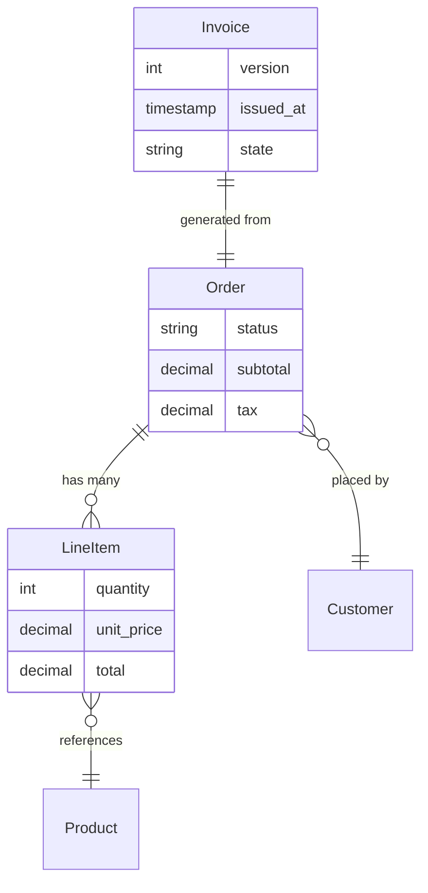
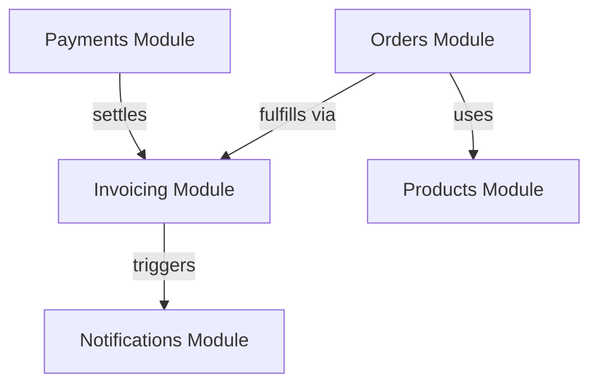
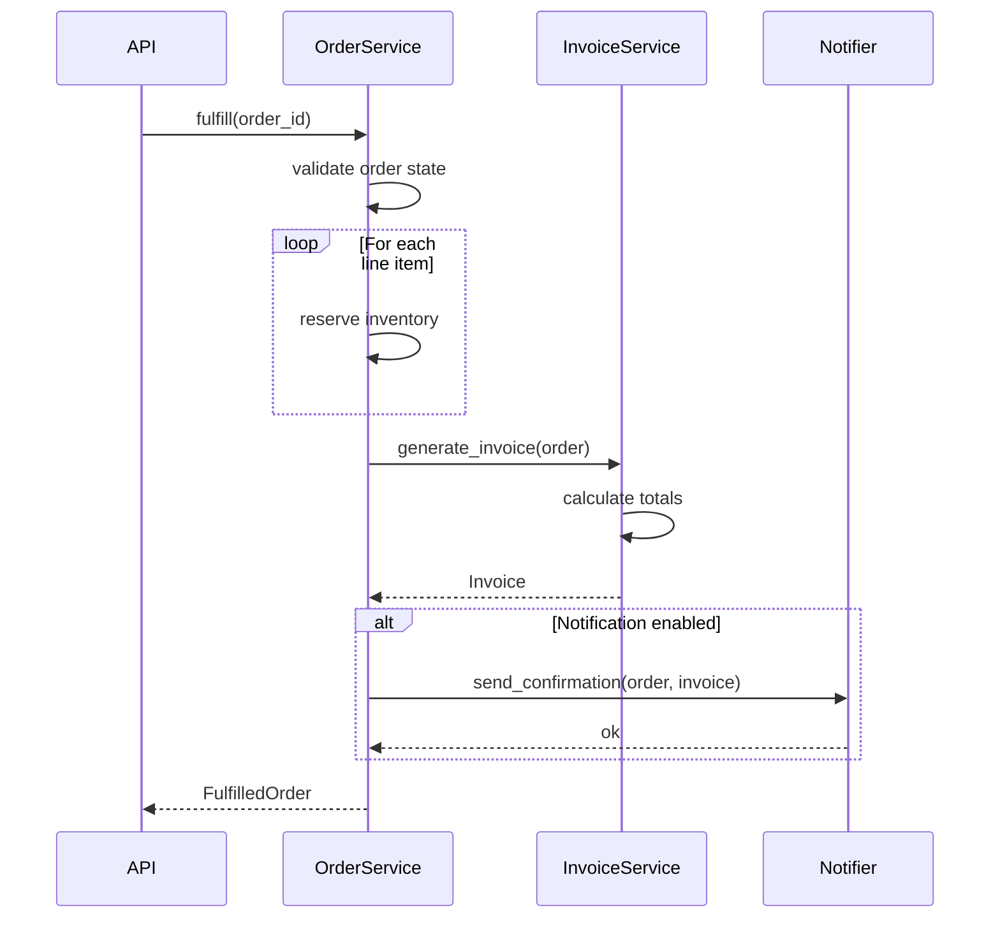
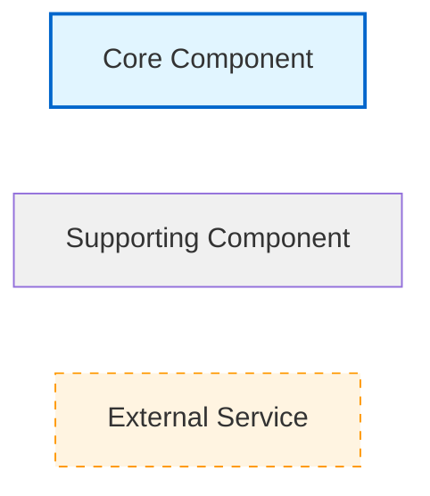
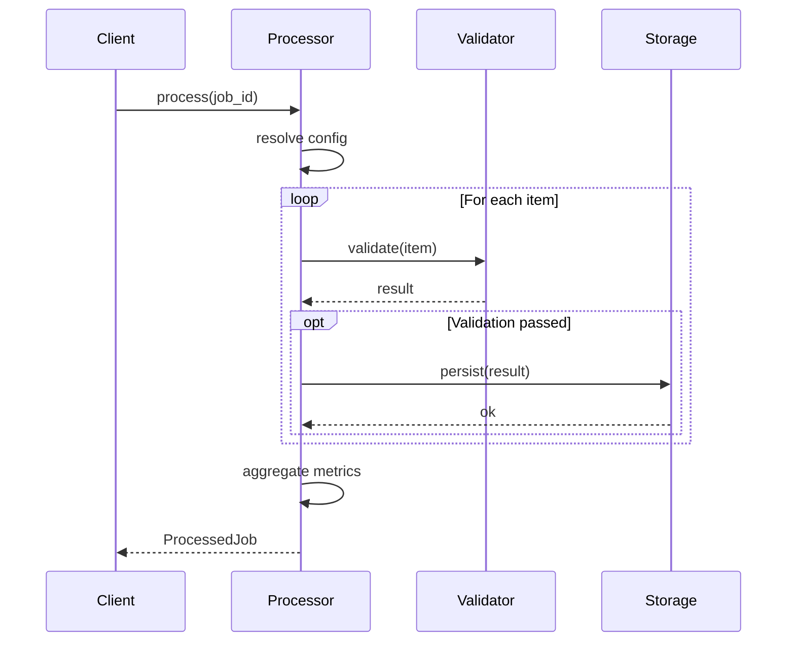
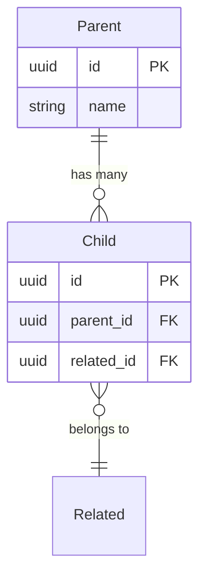
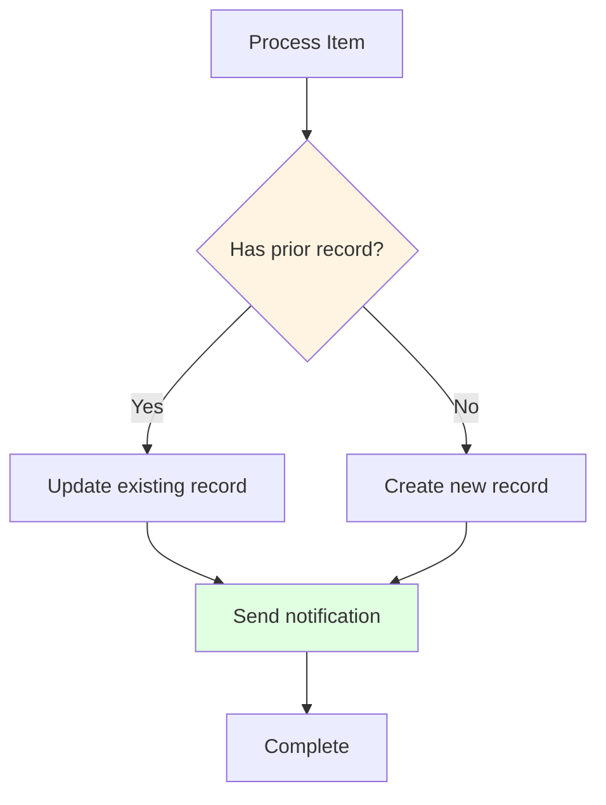
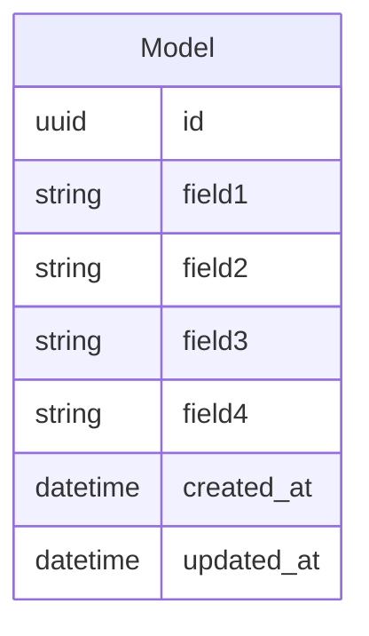
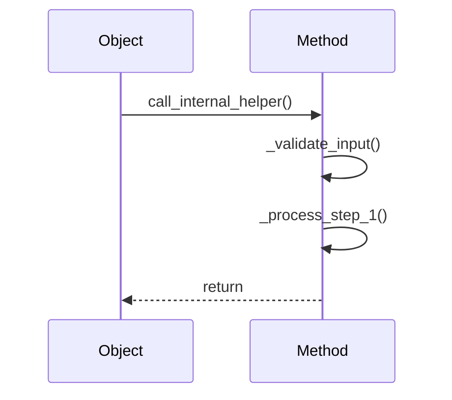
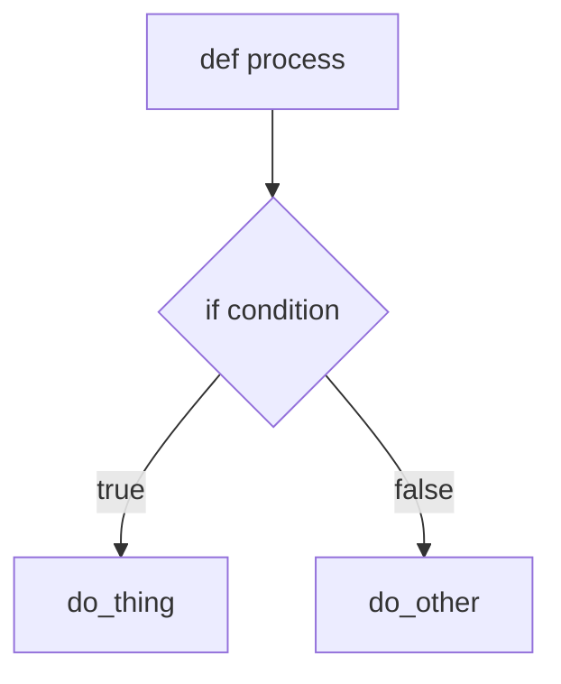

# Diagram Conventions

## Purpose

This document defines conventions for creating Mermaid diagrams in this project. Diagrams serve two primary purposes:
1. **System diagrams** - Show how components and models are related
2. **Sequence diagrams** - Show how data flows through components

Diagrams should clarify architecture and data flow, not replace clear prose or code documentation.

## When to Use Diagrams

### Use Diagrams For:

- **Complex relationships** between models/components that are hard to describe in text
- **Multi-step data flows** through multiple components
- **Decision points** in processing pipelines
- **Architecture overviews** showing major subsystems
- **Processing lifecycles** showing distinct phases
- **Complex algorithms** with multiple phases (scoring, matching, assignment)
- **Complete system documentation** (create separate architecture/algorithm/workflow files)

### Don't Use Diagrams For:

- **Simple two-entity relationships** — prose is clearer ("Order has many LineItems")
- **Implementation details** — code is the source of truth
- **Exhaustive model fields** — reference the model definition instead
- **UI mockups or user flows** — unless the project is a user-facing application

### Scale of Documentation

**Single diagram (simple changes):**
- One or two models added
- Simple data flow changes
- Minor architectural updates

**Multiple diagrams in one file (moderate complexity):**
- Several related diagrams (ERD + sequence)
- Changes affecting 2-3 components
- Standard ticket implementation

**Comprehensive documentation set (complex systems):**
- Create 2-4 separate focused files
- Complex algorithms with multiple phases
- Systems with many interacting components
- End-to-end workflows spanning multiple modules
- See Pattern 4 for examples

## Diagram Types

### 1. Entity Relationship Diagrams (ERD)

**Purpose:** Show how models relate to each other

**Use for:**
- Core model relationships within a module
- Cross-module model dependencies
- Understanding data structure before implementation

**Syntax:** Mermaid ERD

**Example:**

### 2. Component/Architecture Diagrams

**Purpose:** Show how major subsystems interact at a high level

**Use for:**
- Module-level architecture
- Cross-cutting concerns (processing, validation, persistence)
- Understanding system boundaries

**Syntax:** Mermaid flowchart or graph

**Example:**

### 3. Sequence Diagrams

**Purpose:** Show data flow and control flow through components over time

**Use for:**
- Multi-step processing pipelines
- Request/response flows
- State transitions during execution
- Error handling paths

**Syntax:** Mermaid sequence diagram

**Example:**

## Formatting Conventions

### 1. Consistent Naming

**Models and entities:**
- Use PascalCase for model names: `Order`, `LineItem`, `InvoiceVersion`
- Match actual model/class names in code

**Modules and components:**
- Use descriptive names: `Orders Module`, `Invoicing Pipeline`
- Be consistent within a document

**Actions and methods:**
- Use verb phrases: `Calculate totals`, `Validate state`, `Persist result`
- Keep concise but clear

### 2. Visual Clarity

**Node styling:**

**Use styling to indicate:**
- **Primary components** — Light blue fill (`#e1f5ff`)
- **Supporting components** — Light gray fill (`#f0f0f0`)
- **External/infrastructure** — Dashed border or distinct color
- **Error paths** — Red connections or highlights

### 3. Appropriate Detail Level

**Include:**
- Essential components/entities
- Key relationships or flows
- Decision points and error paths
- Cardinality for ERDs (one-to-many, etc.)

**Exclude:**
- Every field on a model (show 2-3 key fields max)
- Implementation details (method signatures, internal state)
- Trivial relationships obvious from naming

## Diagram Placement

### Location in Documentation

**Architecture/overview docs:**
- Place system diagrams early, before detailed prose
- Place sequence diagrams near the relevant section they illustrate

**Implementation tickets:**
- Use diagrams to clarify complex requirements
- Place before Technical Requirements section
- Keep minimal — implementation is in code, not diagrams

**Decision docs:**
- Use diagrams to compare alternatives
- Show before/after for changes

### Inline vs. Reference

**Inline** (embed the diagram):
- First time introducing a concept
- Core to understanding the section
- Small to medium complexity

**Reference** (link to external diagram):
- Very large diagrams
- Reused across multiple documents
- Consider a `docs/diagrams/` directory if this becomes common

## Common Patterns

### Pattern 1: Processing Lifecycle

For showing job or workflow execution flow:

### Pattern 2: Model Relationships

For showing database relationships:

### Pattern 3: Decision Flows

For showing conditional logic or branching:

### Pattern 4: Comprehensive Documentation Sets

For complex systems (algorithms, engines, multi-step workflows), create **separate diagram files** that each focus on one aspect.

**When to use:**
- Complex algorithms with multiple phases (matching, scoring, assignment)
- Systems with multiple interacting components
- Complete workflows that span multiple services or modules
- When you need to show both "what" (architecture) and "how" (algorithms/flows)

**Structure:** Create 2-4 focused files instead of one massive file:

1. **`XXX_DIAGRAMS_ARCHITECTURE.md`** — Component overview and responsibilities
2. **`XXX_DIAGRAMS_ALGORITHM.md`** — Detailed algorithm flowcharts with examples
3. **`XXX_DIAGRAMS_WORKFLOW.md`** — End-to-end sequence diagrams
4. **`XXX_DIAGRAMS_ERD.md`** — Entity relationships (if data model changes)

**Key elements of comprehensive documentation:**

1. **Multiple diagram types** — Architecture, flowcharts, sequences, decision trees
2. **Extensive prose** — Explain what each diagram shows, why it matters
3. **Concrete examples** — Show calculations with actual values, not just variables
4. **Tables** — Weights, components, metrics — anything with structured data
5. **Edge cases** — Document unusual scenarios and how they're handled
6. **Performance notes** — Time/space complexity, typical execution time
7. **Integration points** — How other code calls this, what triggers it

**Benefits:**
- Each file is focused and navigable
- Can reference specific aspects ("see the architecture diagram" vs "see the workflow diagram")
- Easier to maintain (update algorithm without touching architecture)
- Can be read in any order based on reader's needs

**File naming:**
- Use descriptive suffixes: `_ARCHITECTURE`, `_ALGORITHM`, `_WORKFLOW`, `_ERD`, `_SEQUENCE`
- All share the same ticket prefix: `009_DIAGRAMS_*.md`

## Anti-Patterns to Avoid

### ❌ Over-Detailed ERDs

**Why avoid:** Too much detail obscures key relationships. Show 2-3 critical fields.

### ❌ Implementation-Level Sequences

**Why avoid:** This is code documentation, not architectural flow. Let the code speak for itself.

### ❌ Diagrams Instead of Code

**Why avoid:** Duplicating code logic in diagrams creates maintenance burden. Code is the source of truth.

### ❌ Stale Diagrams

Including diagrams that are outdated and don't match current implementation.

**Prevention:**
- Keep diagrams high-level enough to remain stable
- Update diagrams when architecture changes
- Remove diagrams that have drifted and aren't worth updating

## Tools and Rendering

### Mermaid Support

Mermaid diagrams are rendered automatically in:
- GitHub markdown preview
- Many markdown editors (VS Code with extension, Cursor, etc.)
- Documentation sites (if deployed later)

### Live Preview

Use a Mermaid live editor during creation:
- [Mermaid Live Editor](https://mermaid.live)
- VS Code/Cursor with Mermaid extension

### Syntax Reference

Official Mermaid documentation: https://mermaid.js.org/

**Common diagram types:**
- `erDiagram` — Entity relationship diagrams
- `sequenceDiagram` — Sequence/interaction diagrams
- `graph` or `flowchart` — Flowcharts and component diagrams
- `stateDiagram-v2` — State machines (use sparingly)

## Summary

✅ **Use diagrams for complex relationships and flows**
✅ **Keep diagrams high-level and architectural**
✅ **Match actual model/component names from code**
✅ **Style consistently (colors for primary/supporting/external)**
✅ **Show key entities/fields only, not exhaustive detail**
✅ **Place diagrams near relevant prose**
✅ **Update diagrams when architecture changes**
✅ **For complex systems, create separate focused diagram files (architecture, algorithm, workflow)**
✅ **Include concrete examples and calculations in algorithm diagrams**
✅ **Document edge cases, performance, and integration points**

❌ **Don't diagram trivial relationships**
❌ **Don't include implementation details**
❌ **Don't duplicate code logic in diagrams**
❌ **Don't let diagrams go stale**
❌ **Don't create one massive diagram file when separate focused files would be clearer**

Remember: Diagrams clarify **what** the system does and **how** data flows. Code specifies **how** it's implemented. Keep diagrams architectural and let code handle the details.

**For simple changes:** One diagram file may suffice.
**For complex systems:** Create 2-4 focused files covering architecture, algorithms, and workflows separately.
